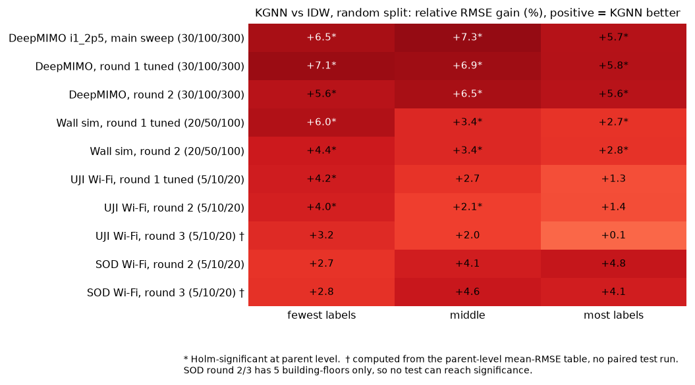
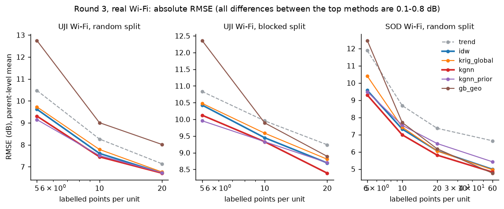
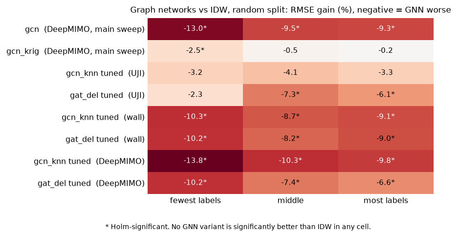
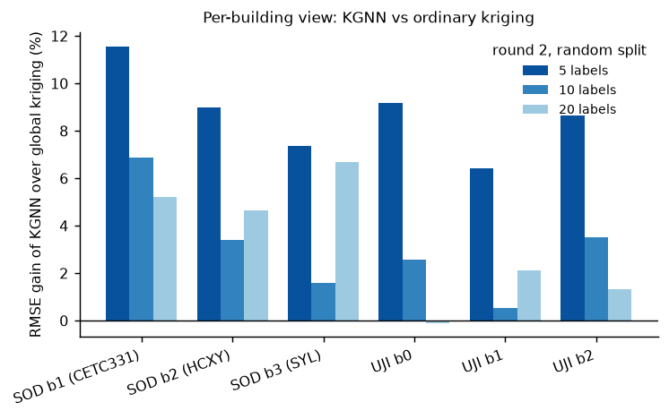
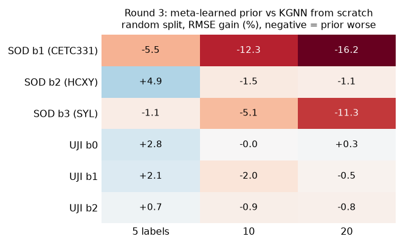
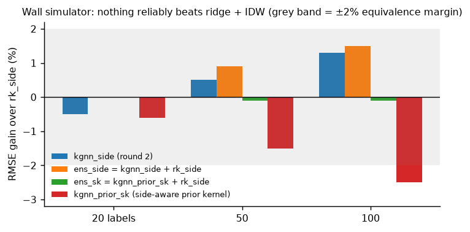
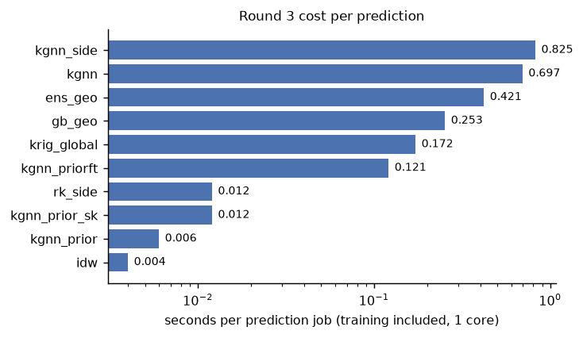

# Sparse radio-map estimation: IDW vs kriging vs graph models, from simulation to real Wi-Fi data

A unit-level benchmark of classical interpolators (IDW, ordinary kriging) and learned models (GCN, GAT, a kriging-initialised graph model called KGNN) that predict received power from a handful of labeled measurements. One *unit* is one transmitter's radio map, and every statistical test is paired across independent parents (transmitters, building-floors or layouts, depending on the dataset).

The work ran in five stages, and the older stages are never overwritten:

| Stage | Notebook | Data | Purpose |
|---|---|---|---|
| **Main sweep** (2026-10-11) | `radiomap_6g_sweep.ipynb` | DeepMIMO `i1_2p5`, `i2_28b` | Classical vs graph models, with sensitivity variants |
| **Round 1** (2026-10-11) | `radiomap_ext_real_crosslayout.ipynb` | UJIIndoorLoc (real Wi-Fi), wall simulator, DeepMIMO | More layouts, robust trend, side information, tuning, transfer, both splits, pre-registration |
| **Round 2** (2026-10-12) | `radiomap_ext_conf2.ipynb` | UJI (fresh APs), SODIndoorLoc (new real data), wall simulator (new layouts), DeepMIMO | Pre-specified replication of the two surviving questions on fresh data |
| **Round 3** | `radiomap_ext_conf3_kriging_attention.ipynb` | UJI, SODIndoorLoc (60-label density added), wall simulator | Meta-learned prior (`kgnn_prior*`), side-aware kernel, ensembles, gradient-boosting baseline (`gb_geo`), cost |
| **Round 4** | `radiomap_ext_conf4_ablation.ipynb` | Round-3 real Wi-Fi units (UJI, SOD), fresh test salt `abl4` | Ablation: where does KGNN's edge come from? Learned parameters vs the fixed local-kriging structure |

## Summary of findings

1. **The KGNN advantage is real but small, and it replicates.** KGNN beats IDW in nearly every cell of every dataset and round (+1.3% to +7%, 0.1–0.4 dB on real Wi-Fi, 0.003–0.008 dB on DeepMIMO; Figure 1). In round 3 the sign holds in all 7 real-Wi-Fi random-split cells, but those gains are descriptive (no paired test was run). Against a fitted global kriging it wins in most cells, by 8% at 5 labels on real Wi-Fi but only 1–3% at 10–20 labels.
2. **Only one pre-registered claim passed its own strict rule.** `kgnn` vs `idw` on the wall simulator (6 of 6 cells). The primary claim `kgnn` vs `krig_global` was **NOT SUPPORTED** on real Wi-Fi and on the simulator: 5 of 6 cells were significantly better, and one cell stayed open.
3. **GCN and GAT never beat IDW.** In 3 families, 2 splits and all densities, the plain label-aware GCN/GAT lose to IDW (−2% to −14%), and tuning does not change that.
4. **Side information is what helps, not the learned interpolator.** On the wall simulator a plain ridge regression on wall-count and LOS covariates plus IDW (`rk_side`) beats IDW by 22–23%. Giving the same covariates to KGNN (`kgnn_side`) lands within about ±1% of it. Giving them to a GNN is far worse than `rk_side` (−19% to −34%).
5. **Pre-training on other layouts does not rescue the GNNs.** On real data, GNNs pre-trained on other buildings are not better than IDW (significantly worse at 20 labels). On the simulator they beat IDW but still lose to `rk_side`.
6. **A bad shared trend, not the interpolator, caused the biggest errors at very few labels on real data.** A robust trend selection fixed it (trend-only RMSE at 5 labels fell from 60.8 dB to 11.7 dB).

7. **A meta-learned prior helps only at the very fewest labels on real data.** `kgnn_prior` is the best method at 5 labels on UJI (+4.9% over IDW), but it falls behind from-scratch KGNN as labels grow (−12% on SOD at 20 and 60 labels). It is zero-shot and about 100x cheaper than KGNN (Figure 7).
8. **Gradient boosting on coordinates is a weak baseline at low density and competitive only on dense data.** `gb_geo` is 18–33% worse than IDW on UJI random and 30% worse on SOD at 5 labels, but 4.5% better than IDW at 60 labels on SOD.

9. **Where the edge comes from: the local-kriging structure, not training (round 4).** A local kriging of the K=12 nearest labels with a fixed default covariance (exponential in space, polar term, nugget; **no training at all**) already carries the gain. On UJI (random split) it beats IDW by +2.7% / +2.8% / −0.2% and global kriging by +5.8% / +2.2% / −1.1% at 5 / 10 / 20 labels (Holm-significant at 5 labels vs global kriging and at 10 labels vs IDW). Learning the six covariance parameters on top adds nothing measurable (pooled primary |gain| ≤ 1.1%, ≤ 0.1 dB; verdict NOT ESTABLISHED). The practical consequence is positive: a **training-free local kriging with a nugget** is the cheap, robust method to use at 5–10 labels, and it needs no GNN.

Absolute differences are small compared with the noise of the targets, so always read percentages next to dB values. See [Limitations](#limitations).



*Figure 1. KGNN vs IDW, random split, every dataset and round. Round-3 rows (†) are computed from mean-RMSE tables, not from a paired test.*

### What can and cannot be claimed

| Claim | Status |
|---|---|
| KGNN gives a small, consistent RMSE gain over IDW (about 1–7%) | Replicated across 4 datasets and 3 rounds; Holm-significant in rounds 1–2 at most cells |
| KGNN beats fitted global kriging at 5–10 labels on real Wi-Fi | Consistent in 6 of 6 buildings (round 2); the frozen claim rule is **not met** (one cell open) |
| GCN/GAT beat IDW | **No**, in any family, split or density |
| Side information via a GNN beats ridge + IDW (`rk_side`) | **No** (practically equivalent at best) |
| A meta-learned prior helps | Only at 5 labels on real Wi-Fi and on the wall simulator; hurts at higher density on real data |
| Learning the KGNN kernel beats the same kernel untrained (round 4 primary) | **No / not established.** Pooled real Wi-Fi, 6 cells: −1.1% to +1.0%, none Holm-significant (frozen rule: NOT ESTABLISHED) |
| Training-free local kriging (fixed default covariance + nugget) beats IDW and global kriging at 5–10 labels on real Wi-Fi | **Supported descriptively and in part by Holm-significant secondary contrasts** (UJI random: 2 of 6 cells significant, rest same sign or inconclusive). Not a pre-registered primary |
| The nugget matters | Yes: freezing it at ~0 costs +4.1% RMSE at 20 labels (UJI random, Holm-significant); learning it vs the 0.2 default adds nothing |
| Anything about 6G / mmWave / sub-THz | **Not supported** by these data |



## Files

| File | Purpose |
|---|---|
| `radiomap_6g_sweep.ipynb` | Main DeepMIMO experiment: setup, units, split, correctness checks, tuning, evaluation, paired contrasts, sensitivity variants |
| `rmbench_core.py` | Data loading and preprocessing, shared trend, train/tune/eval split, IDW and kriging, resumable executor, statistics (Wilcoxon, Holm) |
| `rmbench_nn.py` | Torch models: label-aware `GCN`, `gcn_krig` hybrid, `KGNN`, `krig_untrained` (no torch_geometric; the graph is three index tensors) |
| `rmbench_ext.py` | Layer 1: UJIIndoorLoc units, narrowband DeepMIMO target, GAT, Delaunay graphs, outage metrics, leave-one-layout-out transfer, extended executor |
| `run_ext.py` | Command-line runner for layer 1 (`smoke`, `uji`, `deepmimo`). **Exploratory**: its results are not reused in the confirmatory rounds |
| `rmbench_ext2.py` | Layer 2: robust trend, wall simulator, side information, `rk_side`, cross-fitted tuning, pre-registration, transfer, gated outage reporting |
| `rmbench_ext3.py` | Layer 3: SODIndoorLoc, `krig_side` / `kgnn_side`, building-level cluster bootstrap, equivalence margin, programmatic claim evaluation |
| `radiomap_ext_real_crosslayout.ipynb` | Round 1 (confirmatory design, run 2026-10-11) |
| `radiomap_ext_conf2.ipynb` | Round 2 (pre-specified replication, run 2026-10-12) |
| `radiomap_ext_conf3_kriging_attention.ipynb` | Round 3 (meta-learned prior, side-aware kernel, ensembles, gradient boosting) |
| `radiomap_ext_conf4_ablation.ipynb` | Round 4 (KGNN ablation). Section 2 writes `rmbench_ablate.py` (`%%writefile`); the notebook also contains the former `run_ablation.py` as cells |
| `rmbench_ablate.py` | Ablation layer: switchable KGNN fit (`polar`, `freeze`, `tau_zero`, `step0`) and the `kgnn_abl` dispatcher. Adds only; `rmbench_core/nn/ext/ext2/ext3` are untouched |
| `run_ablation.py` | Same ablation driver as the notebook, as a command line (`smoke`, `run`, `report`) |
| `readme_figures.py` | Regenerates every figure in this README into `figures/` from numbers transcribed from the saved notebook outputs (nothing is re-estimated) |

The layers import each other (`ext3` imports `ext2`, which imports `ext`), so **all files must sit together** and none may be saved over another. The extension notebooks run a preflight check that stops with an explanation if a file was overwritten.

## Methods

All methods predict the **same residual** after a shared trend fitted on the training labels only, so no method gets a better trend than another.

| Name | Description |
|---|---|
| `trend` | Trend only, no spatial term |
| `idw` | Inverse-distance weighting; power and neighbourhood chosen by leave-one-out on the labeled points |
| `krig_global` | Ordinary kriging with a variogram fitted on the labeled points |
| `krig_local` | The same, using the K nearest labels |
| `krig_untrained` | KGNN's local kriging with its fixed default covariance and no learning |
| `kgnn` | Kriging-initialised message-passing model: each target is a kriging estimate over its K nearest labels, with a **learned** covariance (exponential in space plus a polar term around the transmitter, and a nugget). Step 0 (plain kriging) is a candidate for early stopping, so it can only move away from kriging if that helps on held-out labels |
| `gcn` | Label-aware GCN: geometric features, observed residual, mask and multi-hop label diffusion; trained by hiding random subsets of the labels |
| `gcn_krig` | The same GCN predicting a correction to a labeled-points-only IDW baseline. The output layer is zero-initialised and step 0 (pure IDW) is an early-stopping candidate |
| `gcn_knn`, `gcn_del`, `gat_knn`, `gat_del` | Extension GNNs. **Graph**: kNN (k=8) or Delaunay triangulation (edges longer than 4x the median are pruned). **Architecture**: GCN or edge-aware multi-head GAT. Same label-aware inputs and episodic masked-label training as `gcn`. `gat_del_idw` is the IDW-anchored hybrid |
| `*_tuned` | Same model after random-search tuning on units disjoint from the evaluation units |
| `*_side` | The same model with extra covariates (wall count along the transmitter-receiver segment, LOS flag) |
| `rk_side` | Regression-kriging comparator: ridge on **the same covariates the GNN sees**, then IDW of the remaining residual. Exists so that a side-information GNN is not compared with a method that cannot use side information |
| `krig_side`, `kgnn_side` | `rk_side` with the leftover residual interpolated by global kriging / KGNN instead of IDW. Each contrast differs from the next in exactly one factor |
| `kgnn_prior`, `kgnn_prior_sk`, `kgnn_priorft` | KGNN whose covariance parameters come from a **meta-learned prior** fitted on other layouts and applied zero-shot. `_sk` uses a side-aware kernel; `_priorft` fine-tunes the prior on the target labels |
| `ens_geo`, `ens_side`, `ens_sk` | Ensembles. `ens_side` = `kgnn_side` + `rk_side`; `ens_sk` = `kgnn_prior_sk` + `rk_side`. `ens_geo` combines the label-aware geometric models (composition: see the round-3 notebook) |
| `gb_geo` | Gradient boosting on coordinates and geometric features (no side information) |
| `xfer_*`, `xferft_*`, `within_*` | GNN pre-trained on **other** layouts and applied zero-shot / with 30 fine-tune steps, versus pre-trained on the same layout (but different floors) as control |

### Mechanisms added in the extension rounds

- **Real Wi-Fi units (UJI, SOD).** One unit = one access point on one floor. AP positions are unknown, so the transmitter is **localised from the labeled points only** (soft-L1 fit of a log-distance model from four starting points). A point counts as detected if at least a set fraction of its captures saw the AP, and undetected points are dropped, so coverage statements are conditional on detection. Layout = building, parent = building-floor.
- **Robust trend (`trend_policy="robust"`).** Three candidate trends (constant, fixed exponent 2, fitted exponent) are compared by K-fold cross-validation on the labeled points, with the transmitter re-localised inside every training fold. The simplest candidate within one standard error of the best is used, and predictions are clipped to the label range. `"legacy"` reproduces the earlier behaviour for before/after tables.
- **Data-only feasibility rule.** How many floors survive is decided from counts (APs detected at enough reference points per floor), never from model results. This is what lifted UJI from 2 usable floors to 12 (setting: densities 5/10/20, 20 test points).
- **Wall simulator (`wall`).** Random buildings (size, interior walls with doors, wall loss, path-loss exponent and shadowing drawn per layout), 6 transmitters each. The only family where layouts are independent draws by construction. Side information is nearly deterministic here, so it says whether a regime exists where side information helps a GNN, not how real buildings behave.
- **Cross-fitted tuning.** Units are split into 2 folds by parent (by layout for `wall`). Hyper-parameters for fold *f* are tuned on the other fold with a separate test-set salt, then frozen. No evaluation unit is ever tuned on. Trial 0 is the library default.
- **Two splits.** `random` (test points interleaved with labels) and `blocked` (test set is one contiguous region, buffer 0). They are pre-registered as separate families and shown side by side. Blocked is the harder, more honest setting.
- **Gated outage metrics.** Outage F1 and accuracy are reported only where IDW has skill ≥ 0.2, classes need ≥ 8 test points, and an absolute dBm threshold is kept only if it splits every layout into 10–90%. Quantile thresholds (from the training labels) are always defined.
- **Pre-registration.** The contrast lists, thresholds, densities, replicate ids, test salt, tuning protocol and claim rule are written to a hashed JSON file (`prereg.json`, `prereg_conf2.json`) before any confirmatory run. Re-running with an identical plan is a no-op, and a different plan raises. Anything designed after seeing earlier output is listed in the file itself.
- **Round-2 statistics.** Parent-level paired tests with Holm correction and bootstrap CI, a **2% equivalence margin** (needs ≥ 8 parents), and a **building-level cluster bootstrap** (needs ≥ 5 buildings), because floors of one building are not independent. The claim rule: a contrast is SUPPORTED only if it is Holm-significant in the claimed direction at **every density in every split** and the building-level CI excludes 0.

## Design rules

- **Unit = one parent.** Replicates are averaged inside a unit, units inside a parent, and tests are paired across parents.
- **Tuning and evaluation units are disjoint.**
- **Label-free features only** (`geo`, `geo_los`, `geo_side`). Nothing is computed from the label's own channel.
- **Power** (DeepMIMO) is the incoherent sum over real paths. Points below the noise floor are dropped.
- **Pre-specified contrasts, a cap on the number of tests, Holm correction** within each (dataset, split, contrast list) family. Every contrast is printed, wins and losses.
- **Resumable JSONL executor.** A failing job never kills a task, and finished tasks are skipped on rerun.
- **Leak test** for every method (Section 3 of the main notebook). A FAIL invalidates that method's column.

## Setup

```bash
pip install numpy scipy pandas matplotlib torch deepmimo
```

- DeepMIMO scenarios `i2_28b`, `i1_2p5` (and `i3_60`, unverified slug) must be available locally or downloadable.
- UJIIndoorLoc downloads from UCI into `data/ujiindoorloc`. SODIndoorLoc downloads from GitHub (`bijingxue/SODIndoorLoc`) into `data/sodindoorloc`. Both need network access on first run.
- Main notebook: `RUN_NEURAL = False` runs only the classical methods (no torch). `USE_SYNTHETIC = True` is an offline smoke test.
- Extension notebooks: `SMOKE = True` runs the plumbing on fake data. It says nothing about science.

## Running

1. Restart the kernel (modules are imported once, in Section 1).
2. Run a notebook top to bottom. In the main notebook run Section 3 (correctness checks) before trusting any number. In the extension notebooks, commit the pre-registration file to git **before** the confirmatory cells.
3. Timings on a 16-core machine (15 workers): main sweep about 9 min tuning plus about 9 min evaluation. Round 2 evaluates in minutes per family because it uses defaults only. Round 1 is the slow one (tuning plus pre-training); lower `pretrain_steps` for a first pass.

**Cache gotcha.** `run_tasks` skips any task id already present in the JSONL file, and a task id covers all of its jobs. If you add a method to the job list and reuse an old cache file, the new method silently never runs. Use a new file name and prefix whenever you change the job list or the code of an existing method (the main notebook uses `tune2.jsonl` / `eval2.jsonl`).

## Results

### Main sweep: DeepMIMO `i1_2p5` (run 2026-10-11)

48 evaluation transmitter maps, 5 replicates per unit, 30 / 100 / 300 labels, 1000 test points. The trend alone has an RMSE of 0.15 dB, and all methods sit between 0.05 and 0.11 dB. Percentages are the relative RMSE gain of the first method over the second (positive means the first is better). ✔ = significant after Holm correction over 33 tests.

| Comparison | 30 labels | 100 labels | 300 labels |
|---|---|---|---|
| `kgnn` vs `idw` | +6.5% ✔ | +7.3% ✔ | +5.7% ✔ |
| `kgnn` vs `krig_global` | +1.3% | +1.4% | +3.2% ✔ |
| `kgnn` vs `krig_untrained` | +0.6% | +0.6% ✔ | +0.9% ✔ |
| `gcn_krig` vs `idw` | −2.5% ✔ | −0.5% | −0.2% |
| `gcn_krig` vs `krig_global` | −8.2% ✔ | −6.8% ✔ | −2.9% ✔ |
| `gcn` vs `idw` | −13.0% ✔ | −9.5% ✔ | −9.3% ✔ |
| `gcn` vs `krig_global` | −19.3% ✔ | −16.4% ✔ | −12.2% ✔ |
| `krig_global` vs `idw` | +5.3% ✔ | +5.9% ✔ | +2.6% ✔ |

The KGNN gain over `krig_global` is 0.0010–0.0018 dB, and over `idw` 0.0033–0.0063 dB. `i2_28b` has a single unit, so it is descriptive only (at 300 labels KGNN has the lowest RMSE: about 0.54 dB vs 0.59 for IDW and 0.64 for global kriging).

**Sensitivity variants** (automatic, Section 7c; declared in code before any variant result existed; `*` = significant after Holm within each variant):

| Contrast | primary | `trend_fspl` (exponent fixed at 2) | `blocked` (contiguous test region) | `channel` (channel-power target) |
|---|---|---|---|---|
| `kgnn` vs `idw` | +6.5* / +7.3* / +5.7* | +6.7* / +7.2* / +5.7* | +5.2 / +4.7* / +3.6* | −4.2* / +4.0* / +3.5* |
| `kgnn` vs `krig_global` | +1.3 / +1.4 / +3.2* | +1.3 / +1.2 / +3.1* | −0.5 / −3.9 / −9.6 | −4.9* / +2.6* / +4.1* |
| `gcn_krig` vs `idw` | −2.5* / −0.5 / −0.2 | −2.3* / −0.5 / −0.3 | −0.4 / −0.1 / +0.0 | −1.9* / −1.1* / −0.5* |
| `gcn_krig` vs `krig_global` | −8.2* / −6.8* / −2.9* | −8.3* / −7.1* / −3.1* | −6.4 / −9.2 / −13.6 | −2.5* / −2.5* / +0.0 |
| `gcn` vs `idw` | −13.0* / −9.5* / −9.3* | −16.3* / −11.3* / −10.1* | +0.7 / −0.2 / −1.5 | −5.7* / −3.9* / −3.5* |

`trend_fspl` reproduces the primary results almost exactly. KGNN beats IDW in 10 of 12 cells, and beats global kriging significantly in 4 of 12 (under `blocked` the sign reverses, none significant). No GCN variant beats IDW or global kriging in any cell. The 12 cells are not independent, so the counts describe consistency, not 12 confirmations.

### Round 1: more layouts, tuning, side information, transfer (run 2026-10-11)

**Data.** UJI: 96 units from 12 building-floors in 3 buildings (the old setting kept only 2 of 13 floors). Wall simulator: 72 units in 12 layouts. DeepMIMO path-sum: 27 units (24 from `i1_2p5`; `i2_28b` and `i3_60` are descriptive only). Relative RMSE gain (%) of A over B, `*` = Holm-significant, random vs blocked:

| Family | Contrast | random (low / mid / high density) | blocked |
|---|---|---|---|
| UJI (5/10/20 labels) | `kgnn_tuned` vs `idw` | +4.2* / +2.7 / +1.3 | +3.0* / +2.2 / +0.6 |
| | `gat_del_tuned` vs `idw` | −2.3 / −7.3* / −6.1* | −3.4 / −5.8 / −1.9 |
| | `gcn_knn_tuned` vs `idw` | −3.2 / −4.1 / −3.3 | −8.6 / −3.6 / +0.2 |
| | `krig_global` vs `idw` | −4.0 / −0.7 / −0.7 | −4.5 / −0.8 / −1.4 |
| Wall (20/50/100) | `kgnn_tuned` vs `idw` | +6.0* / +3.4* / +2.7* | +4.7 / +3.6 / +2.6 |
| | `gat_del_tuned` vs `idw` | −10.2* / −8.2* / −9.0* | −1.8 / −0.8 / +2.1 |
| | `gcn_knn_tuned` vs `idw` | −10.3* / −8.7* / −9.1* | −4.2 / −0.7 / +1.3 |
| DeepMIMO (30/100/300) | `kgnn_tuned` vs `idw` | +7.1* / +6.9* / +5.8* | +3.3* / +4.3* / +2.9* |
| | `gat_del_tuned` vs `idw` | −10.2* / −7.4* / −6.6* | −5.4 / +5.2 / −0.6 |
| | `gcn_knn_tuned` vs `idw` | −13.8* / −10.3* / −9.8* | −7.8 / −0.0 / −3.2 |



*Figure 4. No GNN variant is significantly better than IDW in any cell.*

- **Tuning barely matters.** Tuned and default KGNN do not differ significantly anywhere (|difference| ≤ 0.3%). Tuned GCN/GAT gain at most about 2%, never significantly. The tuned GNNs still lose to IDW, so the earlier "GNNs may be under-tuned" worry does not explain their deficit.
- **Topology and architecture are second-order.** GAT vs GCN and Delaunay vs kNN differ by 0–2%, mostly not significant.
- **Side information (wall simulator, random split).** `rk_side` beats `idw` by 22–23% (RMSE 4.87 vs 6.27 dB at 20 labels). Side information also helps GNNs (`gat_del_side` vs `gat_del` +13–15%, `gcn_knn_side` vs `gcn_knn` +5–7%) and `gat_del_side` beats `idw` by 4–7%, but both side GNNs lose to `rk_side` by 19–34%, significantly. On DeepMIMO, `rk_side` is within ±1.5% of IDW at 100 and 300 labels, and side GNNs again lose to it by 10–18%.
- **Transfer.** On UJI (leave-one-building-out, within-building control trained on other floors of the same building), `xfer_*` is not better than IDW (−1% / −5% / −9%, significantly worse at 20 labels), and is worse than scratch-trained GNNs at 20 labels. On the wall simulator `xfer_*_side` beats IDW (+5% to +25%, Holm-significant) but loses to `rk_side` (random split: −8% to −30%; blocked: not significant). Fine-tuning for 30 steps gives lower RMSE descriptively; see the saved tables.
- **Trend repair (exploratory).** On 12 floors, 5 labels: trend-only RMSE 60.8 → 11.7 dB, IDW 13.8 → 10.9 dB, kriging 13.8 → 11.2 dB. None of these is significant after Holm at 12 floors, but the direction is consistent. At 5 labels the CV picks the constant trend in all 72 cases, so a fitted distance exponent was not trusted.
- **Predictability.** Noise fraction (nugget share of the residual variogram) is ≈0.03 for DeepMIMO path-sum, 0.28–0.52 for UJI, and 0.01–0.15 for the wall simulator. The `i1_2p5` target is almost deterministic, which is why dB effects there are in the thousandths. Absolute-dBm outage thresholds did not split `i1_2p5` at all (0% below every candidate) and were dropped; quantile thresholds were used.

### Round 2: pre-specified replication on fresh data (run 2026-10-12)

The hypotheses were chosen after round 1, but the **data** are fresh: new UJI APs (89 units, none overlapping round 1), **SODIndoorLoc** (50 units, 5 building-floors in 3 buildings), 16 new wall layouts (96 units), a new test salt and new replicate ids. DeepMIMO `dm_path` reuses the same transmitters and is never used for a claim. Methods are library defaults only (no tuning, no GCN/GAT arms). Real data are pooled (`real_wifi`: UJI + SOD, 17 building-floors, **6 buildings**, densities 5/10/20).

Relative RMSE gain (%) of A over B, `*` = Holm-significant at parent level:

| Family | Contrast | random | blocked |
|---|---|---|---|
| `real_wifi` (5/10/20) | `kgnn` vs `krig_global` | +8.7* / +3.1* / +2.2* | +8.3* / +2.4* / +1.7 |
| | `kgnn` vs `idw` | +3.6* / +2.7* / +2.3* | +3.3 / +1.7 / +1.6 |
| | `krig_global` vs `idw` | −5.6* / −0.4 / +0.1 | −5.4 / −0.7 / −0.1 |
| `wall` (20/50/100) | `kgnn` vs `krig_global` | +2.7* / +1.4* / +1.1* | +3.6* / +3.3* / +2.2 |
| | `kgnn` vs `idw` | +4.4* / +3.4* / +2.8* | +3.0* / +2.4* / +2.2* |
| | `kgnn_side` vs `rk_side` | −0.5* / +0.5 / +1.3* | −0.6 / −0.1 / +0.2 |
| | `kgnn_side` vs `krig_side` | −0.5* / −0.0 / +0.4 | −0.5 / −0.3 / +0.1 |
| | `kgnn_side` vs `kgnn` | +14.4* / +18.1* / +18.5* | +16.2 / +20.2* / +21.0* |
| `dm_path` (30/100/300; descriptive) | `kgnn` vs `idw` | +5.6* / +6.5* / +5.6* | +3.4* / +3.7* / +3.4* |
| | `kgnn` vs `krig_global` | +1.1 / +0.7 / +2.5 | +1.6 / −0.8 / −6.3 |

Absolute size on real data: UJI RMSE at 5 labels is 8.88 dB (`kgnn`), 9.25 (`idw`), 9.67 (`krig_global`), so the KGNN gain is about 0.4 dB over IDW and 0.8 dB over kriging, shrinking to about 0.1 dB at 20 labels.

**Building-level view.** KGNN beats global kriging in all 6 buildings at 5 labels and in 5–6 of 6 at 10 and 20 labels (per-building gain −0.1% to +11.6% for random, −0.5% to +19.1% for blocked). The building-level cluster-bootstrap CI excludes 0 at all three densities in both splits. With 6 buildings the smallest possible exact sign-test p-value is 0.031, so this supports consistency and effect size, not strong significance.

**Programmatic claim evaluation** (exact rule from the pre-registration):

| Family | Contrast | Primary | Status | Cells better / worse / equivalent / open (of 6) |
|---|---|---|---|---|
| `real_wifi` | `kgnn` vs `krig_global` | H4 | NOT SUPPORTED | 5 / 0 / 0 / 1 |
| `wall` | `kgnn` vs `krig_global` | H4 | NOT SUPPORTED | 5 / 0 / 0 / 1 |
| `wall` | `kgnn_side` vs `rk_side` | H5 | NOT SUPPORTED | 1 / 1 / 4 / 0 |
| `wall` | `kgnn` vs `idw` | no | **SUPPORTED: A better** | 6 / 0 / 0 / 0 |
| `real_wifi` | `kgnn` vs `idw` | no | NOT SUPPORTED | 3 / 0 / 0 / 3 |
| `wall` | `kgnn_side` vs `kgnn` | no | NOT SUPPORTED | 5 / 0 / 0 / 1 |

"NOT SUPPORTED" with 5 of 6 cells better means the direction is consistent but one cell (the blocked, highest-density cell) misses Holm significance; it is not evidence against the effect. The honest reading of H5 is that `kgnn_side`, `krig_side` and `rk_side` are practically equivalent: once the covariates are regressed out, the choice of interpolator for the leftover residual does not matter.



*Figure 3. Per-building gain over global kriging, round 2, random split.*

**Do round-1 effect sizes replicate?** (exploratory) `kgnn` vs `idw` is stable (UJI +4.5 / +2.2 / +1.5 → +4.0 / +2.1 / +1.5 random; wall +5.8 / +3.3 / +2.7 → +4.4 / +3.4 / +2.8; DeepMIMO within ±1.5 points). `krig_global` vs `idw` is **not** stable (wall blocked +2.8 / +3.1 / +3.1 → −0.7 / −1.0 / −0.0, UJI at 20 labels flips sign), so kriging's edge over IDW should not be relied on.

### Round 3: meta-learned prior, side-aware kernel, gradient boosting (real Wi-Fi and wall simulator)

Round 3 was designed after rounds 1 and 2. Under your frozen claim rule all primary contrasts (H6 and H7) came out **NOT SUPPORTED**, and they must be reported as such. <!-- TODO: add the H6/H7 contrast definitions, the cells better/worse/equivalent/open counts, the unit counts per family, seed, test salt and prereg hash from the round-3 notebook; they were not available when this README was updated. -->

**Mean RMSE (dB), parent-level, real Wi-Fi.** Bold = lowest in the column.

| Family | Labels | `trend` | `idw` | `krig_global` | `kgnn` | `kgnn_prior` | `gb_geo` |
|---|---|---|---|---|---|---|---|
| UJI, random | 5 | 10.478 | 9.622 | 9.730 | 9.310 | **9.150** | 12.753 |
| | 10 | 8.265 | 7.610 | 7.789 | **7.454** | 7.511 | 9.009 |
| | 20 | 7.137 | 6.718 | 6.761 | **6.710** | 6.733 | 8.016 |
| UJI, blocked | 5 | 10.835 | 10.428 | 10.479 | 10.124 | **9.957** | 12.362 |
| | 10 | 9.955 | 9.449 | 9.585 | **9.330** | 9.331 | 9.894 |
| | 20 | 9.238 | 8.694 | 8.805 | **8.388** | 8.701 | 8.891 |
| SOD, random | 5 | 11.880 | 9.570 | 10.402 | **9.300** | 9.489 | 12.468 |
| | 10 | 8.686 | 7.326 | 7.436 | **6.989** | 7.543 | 7.705 |
| | 20 | 7.367 | 6.061 | 6.051 | **5.810** | 6.483 | 6.177 |
| | 60 | 6.643 | 4.986 | 4.959 | 4.825 | 5.423 | **4.762** |

Relative gain (%) computed from these means (descriptive, **no paired test**):

| Family | Labels | `kgnn` vs `idw` | `kgnn` vs `krig_global` | `kgnn_prior` vs `idw` | `kgnn_prior` vs `kgnn` | `gb_geo` vs `idw` |
|---|---|---|---|---|---|---|
| UJI, random | 5 / 10 / 20 | +3.2 / +2.0 / +0.1 | +4.3 / +4.3 / +0.8 | +4.9 / +1.3 / −0.2 | +1.7 / −0.8 / −0.3 | −32.5 / −18.4 / −19.3 |
| UJI, blocked | 5 / 10 / 20 | +2.9 / +1.3 / +3.5 | +3.4 / +2.7 / +4.7 | +4.5 / +1.2 / −0.1 | +1.6 / −0.0 / −3.7 | −18.5 / −4.7 / −2.3 |
| SOD, random | 5 / 10 / 20 / 60 | +2.8 / +4.6 / +4.1 / +3.2 | +10.6 / +6.0 / +4.0 / +2.7 | +0.8 / −3.0 / −7.0 / −8.8 | −2.0 / −7.9 / −11.6 / −12.4 | −30.3 / −5.2 / −1.9 / +4.5 |

- **KGNN holds up on fresh real data.** It is ahead of IDW and of global kriging in every real-Wi-Fi cell above, but the UJI random gain at 20 labels is 0.1%, i.e. nothing.
- **The prior is a low-label tool.** It is the lowest-RMSE method at 5 labels on UJI (random and blocked), then loses to from-scratch KGNN. On SOD it is worse than IDW from 10 labels on. Per building (Figure 5) it is worse than scratch KGNN in most cells, with SOD b1 and b3 the worst (−11% to −16% at 20 labels).
- **Gradient boosting** is far worse at low density. It only wins at 60 labels on SOD (+4.5% over IDW, +1.3% over KGNN). Its tuning status is not documented here; see [Limitations](#limitations).
- **Wall simulator.** Nothing reliably beats `rk_side` (Figure 6). `ens_side` is within +1.5% and `kgnn_prior_sk` is up to 2.5% worse; all differences sit inside or at the edge of the ±2% equivalence margin.
- **Cost.** `kgnn_prior` costs 0.006 s per prediction job against 0.697 s for `kgnn` (Figure 7), which is its practical argument.







### Round 4: how much of KGNN is learning? (real Wi-Fi ablation, run 2026-10-13)

**Design.** Seven arms share Kmax = 12, `s2_init` = 0.3 and common random numbers (the seed comes from the labelled indices, not the arm name, so paired differences carry no seed noise): `abl_full` (stock KGNN), `abl_untr_polar` (0 steps, polar term on), `abl_untr_nopolar` (0 steps, polar off; identical to `krig_untrained`), `abl_nopolar`, `abl_nonug_fixed` (nugget frozen at 0.2), `abl_nonug_zero` (nugget ~0) and `abl_nostep0` (untrained checkpoint not a validation candidate). Data: the round-3 real Wi-Fi units (UJI 66 units / 11 building-floors / 3 buildings; SOD 47 units / 5 building-floors / 3 buildings; pooled 16 parents, 6 layouts), densities 5/10/20 (SOD also 60, not pooled), random and blocked splits, test salt `abl4`, replicate ids 700+, 5 replicates, defaults only, no failed jobs. The plan is frozen in `results_ablation/prereg_ablation.json`. **Primary:** `abl_full` vs `abl_untr_polar`, pooled. Holm per (family, split) call over 36 tests.

**Checks.** `krig_untrained` and `abl_untr_nopolar` agree exactly (max |ΔRMSE| = 0.00 dB in all 6 family-split tables), and `kgnn` vs `abl_full` differ by at most 0.005 dB on average (seed only).

**Primary (pooled real Wi-Fi), relative RMSE gain of learned over untrained polar kriging:**

| Split | Labels | gain | ΔRMSE (dB) | Holm p | layout CI > 0 |
|---|---|---|---|---|---|
| random | 5 / 10 / 20 | −0.9% / −0.2% / +1.0% | −0.08 / −0.01 / +0.07 | 1.00 / 1.00 / 0.19 | no / no / yes |
| blocked | 5 / 10 / 20 | −0.4% / −1.1% / −0.2% | −0.05 / −0.11 / −0.02 | 1.00 / 0.81 / 1.00 | no / no / no |

Frozen rule outcome: **NOT ESTABLISHED**. Five of six cells have a parent-level CI inside ±2%; blocked at 10 labels does not, so EQUIVALENT is not declared either. No cell is significantly worse.

**What does carry the gain (UJI, random split, relative RMSE gain of A over B, `*` = Holm-significant; from `figures/abl_uji_random_*`; the pooled and SOD tables are in `figures/` and have not been transcribed here):**

| Contrast | 5 labels | 10 labels | 20 labels |
|---|---|---|---|
| untrained polar kriging vs `krig_global` | +5.8%* | +2.2% | −1.1% |
| untrained polar kriging vs `idw` | +2.7% | +2.8%* | −0.2% |
| polar term, no learning (`abl_untr_polar` vs `abl_untr_nopolar`) | +0.1% | −0.1% | −0.2% |
| nugget at all (`abl_full` vs `abl_nonug_zero`) | −0.4% | +2.1% | +4.1%* |
| learned nugget vs fixed 0.2 (`abl_full` vs `abl_nonug_fixed`) | −1.1% | −0.4% | +0.4% |
| learned polar term (`abl_full` vs `abl_nopolar`) | +1.5%* | +0.2% | −0.1% |
| step-0 candidate (`abl_full` vs `abl_nostep0`) | 0.0% | 0.0% | −0.1% |

RMSE (dB, UJI random): IDW 9.070 / 7.606 / 6.825, untrained polar kriging 8.826 / 7.389 / 6.837, `abl_full` 8.864 / 7.385 / 6.750.

**Reading.** The advantage over IDW and global kriging at 5–10 labels is already there with **no training**. The covariance structure (local neighbourhood, nugget) is what matters; the polar term is neutral untrained and gives a small gain only when learned at 5 labels. The honest name for the method is therefore *local kriging with a fixed, sensible covariance and a nugget*. KGNN's learned parameters are optional.

**Diagnostic caveat.** In `abl_fig3_share_left_step0.png` about 70% of `abl_full` fits at 20 and 60 labels left step 0 (the validation-selected checkpoint was a trained one), so learning did move the parameters; the held-out gain was still about zero. Bars at 5 and 10 labels are empty, which is probably an artifact of an empty validation split at so few labels (`best_ep` stays 0); do not cite that figure for 5 and 10 labels until `_split_val` is checked.

## Limitations

- **Hypotheses were chosen after seeing round 1.** Round 2 has fresh data, not fresh hypotheses, and the plan says so. The trend policy, outage gating and dataset choices were also designed after exploratory output (listed in `prereg.json`).
- **Few independent layouts.** The main sweep and the DeepMIMO families have one building layout. Real data have 6 buildings (UJI 3, SOD 3; SOD has 3 floors in one building and one floor in each of the others). Building-level inference cannot reach strong significance, and the cluster bootstrap with 6 clusters is itself approximate.
- **Tiny effects on DeepMIMO.** The `i1_2p5` scenario is 100% line-of-sight and the path-power target is nearly deterministic (skill 0.99). KGNN's win over kriging is about 0.002 dB, and the larger channel-power residuals come from the target definition, not from its trend. On real Wi-Fi the effect is larger in dB but shrinks to 1–2% by 20 labels.
- **The kriging comparison is the strong one, and it is only partly established.** IDW is the weaker baseline. In the main sweep only the 300-label win over global kriging survived correction. In the round-1 and round-2 DeepMIMO subsets (24–27 units) it does not, and under the blocked split the sign reverses on DeepMIMO.
- **Wall simulator is the author's own.** Wall counts and LOS are almost deterministic drivers of the loss, so side information is highly informative by construction. It says nothing about real buildings. UJI and SOD have no side information.
- **Wi-Fi RSS is not 6G.** UJI and SOD are 2.4/5 GHz with censored detections and **estimated** AP positions. Nothing here says anything about mmWave or sub-THz propagation. Layout and band are also confounded across DeepMIMO scenarios (`i2_28b` at 28 GHz, `i1_2p5` at 2.5 GHz), and single-/two-transmitter scenarios (`i2_28b`, `i3_60`) stay descriptive.
- **Tuning is parent-disjoint, not layout-disjoint,** for UJI and DeepMIMO (sibling floors / transmitters of the same building can sit in the tuning fold). It is layout-disjoint for `wall`. The tuning budget is small (8 trials per neural method), though tuning made no difference.
- **Blocked split uses buffer 0:** labeled points may sit right next to the test block.
- **`gcn_krig` at 30 labels** uses only 6 labeled points for early stopping; its loss to IDW there may reflect noisy selection (not tested).
- **Not tested:** kriging with the true AP position known (SOD ships AP coordinates) and any deep radio-map baseline (a RadioUNet-style model). Gradient boosting is covered only by `gb_geo` in round 3 (geometric features, real Wi-Fi). State its tuning budget next to any claim about it, because a 18–33% loss at low density will look under-tuned to a reviewer. The `i3_60` slug and the narrowband channel shape are unverified.
- **Round-3 hypotheses were also chosen after earlier output,** and all its primaries are NOT SUPPORTED. Round-3 gains over IDW and kriging in Figure 1 and the tables above are descriptive. Do not relabel the primaries by restricting to densities or splits that look best.
- **Six buildings** remain the weakest point for real-data inference; adding buildings (Tampere, UTSIndoorLoc, MallIndoorLoc) is the most valuable next step.
- **Round-4 limits.** The data are the round-3 units (fresh test salt and replicate ids, not fresh buildings). The training-free-kriging claim comes from secondary contrasts; only the learning-vs-untrained contrast was the primary, and it was not established. Do not describe round 4 as showing that learning helps, or relabel the primary using the cells that look best (random split at 20 labels, +1.0%, Holm p = 0.19).
- **Exploratory outputs.** `run_ext.py` runs and the trend-repair table are exploratory. Only contrasts frozen in a pre-registration file are labelled confirmatory.

## Reproducibility

- Seeds are fixed in the config; per-task seeds derive from a stable hash of the task id. Round 1 uses `seed=1` (AP sample), test salt `conf1`, replicate ids 100+. Round 2 uses `seed=2`, test salt `conf2`, replicate ids 200+. The exploratory runs used `seed=0`.
- Pre-registration files (`results_ext2/prereg.json`, written 2026-10-11, sha256 `97162105…`; `results_conf2/prereg_conf2.json`, written 2026-10-12, sha256 `e8a2305d…`, which also embeds the round-1 hash) should be committed to git before the confirmatory cells are run.
- Figures: `python readme_figures.py` writes `figures/*.png`. All numbers in it are transcribed from the saved notebook outputs, and the round-3 relative gains are computed from the parent-level mean-RMSE tables, not from paired tests.
- Round 4 uses test salt `abl4`, replicate ids 700+, plan in `results_ablation/prereg_ablation.json`; smoke runs write to `ablation_smoke/` and never to `figures/`.
- Results come from the saved notebook outputs and the `confirmatory_master*.csv` / `claims_conf2.csv` files they write.
- Tuned hyper-parameters in the main sweep: `gcn`: hidden 32, 2 layers, lr 0.0095, `geo` features. `gcn_krig`: hidden 16, 3 layers, lr 0.0059, dropout 0.3, `geo_los` features. `kgnn`: Kmax 12, lr 0.011, `s2_init` 0.3. Round 2 defaults: Kmax 12, `s2_init` 0.3, 150 steps.
